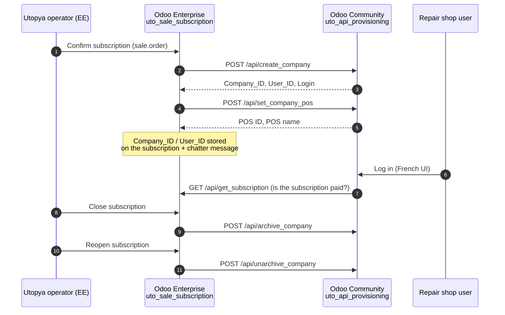

# Utopya

Utopya is a multi-company platform, built on **Odoo 18**, for electronic device repair shops in **France** (smartphones, tablets, laptops, smartwatches…).

It is split into two Odoo instances that talk to each other over HTTP/JSON:

| Edition | Odoo instance | Role |
|---|---|---|
| **Enterprise Edition (EE)** | Odoo 18 Enterprise | Back-office of the Utopya operator: sells and manages **subscriptions** of repair shops (Standard / Premium). |
| **Community Edition (CE)** | Odoo 18 Community | The application used by the repair shops: **repair workshop**, **point of sale**, stock, invoicing, Ecologic / Ecosystem (QualiRépar) claims. |

**Each client subscribed in the Enterprise edition gets its own company in the Community edition.** Every company works as an independent shop with its own point of sale, its own repair workshop, warehouse, products, contacts, journals and admin user.

---

## Table of contents

- [How it works](#how-it-works)
- [Repository layout](#repository-layout)
- [Enterprise Edition addons](#enterprise-edition-addons)
- [Community Edition addons](#community-edition-addons)
- [Community Edition theme](#community-edition-theme)
- [APIs between the two instances](#apis-between-the-two-instances)
- [Ecologic & Ecosystem (QualiRépar) integration](#ecologic--ecosystem-qualirépar-integration)
- [Installation](#installation)
- [Configuration](#configuration)
- [Security notes](#security-notes)
- [Authors & license](#authors--license)

---

## How it works



### Subscription lifecycle

1. **Subscription confirmed (EE)** – when a subscription `sale.order` is confirmed, EE sends the customer's data (name, address, phone, email, VAT, website) and the plan (`is_standard` / `is_premium`) to CE.
2. **Company provisioning (CE)** – CE creates:
   - a `res.company` in **EUR**, country **France**, with the *Bubble* report layout;
   - an admin user `<Client name> Admin` whose login is the client's email, language `fr_FR`, restricted to that company only, with the groups: Internal User, POS User, Inventory User, Billing, Sales Manager and **Company Main User**;
   - a warehouse named after the company.
3. **Point of sale provisioning (CE)** – EE then asks CE to create the shop's point of sale:
   - a single POS **"Caisse Principale"** limited to the 4 business categories (*Devices*, *Accessoires*, *Pièces Détachées*, *Main d'œuvre & Forfaits*);
   - a bank account `512004` and journal **"Banque Bonus reparation"** (`BNK2`) used for repair bonus (QualiRépar) payments;
   - the default "Customer Account" POS payment method is archived.
4. **IDs kept on the subscription (EE)** – the CE `Company_ID` and `User_ID` are stored on the subscription (`related_community_company_id`, `related_community_user_id`) and logged in the chatter.
5. **Subscription closed (EE)** → the CE company and its admin user are **archived**.
6. **Subscription reopened (EE)** → the CE company and its admin user are **unarchived**.
7. **Payment check (CE)** – the CE navbar calls back EE (`/api/get_subscription`) to know whether the subscription's invoice is paid, displays a trial/expiry message (15 days from company creation) and links to the subscription in the EE customer portal (`/my/subscriptions/<id>`).

---

## Repository layout

```
utopya/
├── ce_addons/                  # Community Edition addons (repair shops)
│   ├── uto_base/               # Common base: partners, companies, products, used goods VAT, UI tweaks
│   ├── uto_api_provisioning/   # API receiving the provisioning orders from EE
│   ├── uto_apis/               # Ecologic & Ecosystem API connectors
│   ├── uto_repair/             # Repair workshop
│   ├── uto_pos/                # Point of sale customizations
│   ├── uto_stock/              # Product categories & product rules
│   └── uto_webclient/          # Web client: navbar subscription banner, link to EE
└── ee_addons/                  # Enterprise Edition addons (subscription back-office)
    ├── uto_base/               # Base module of the EE side
    └── uto_sale_subscription/  # Subscription plans & provisioning calls to CE
```

> ⚠️ Both editions contain a module named `uto_base`. They are **different modules** and must only be installed on their own instance (`ce_addons/uto_base` on CE, `ee_addons/uto_base` on EE).

---

## Enterprise Edition addons

Installed on the **Odoo 18 Enterprise** instance (requires the Enterprise `sale_subscription` app).

### `uto_base` (EE)

Empty base module (depends on `base`), reserved for shared EE customizations.

### `uto_sale_subscription`

Manages the subscription of repair shops and drives the provisioning of their companies in CE.

- **Offer type on products** – `product_offer_type`: *Standard* or *Premium*.
- **Offer type on subscriptions** – `subscription_offer_type` computed from the order lines (all Standard → Standard, all Premium → Premium, mixed → empty).
- **Settings** – *Odoo Community URL* (`community_config.odoo_community_url`) with a **Test connection** button.
- **`action_confirm`** → `POST /api/create_company` then `POST /api/set_company_pos` on CE.
- **`set_close`** → `POST /api/archive_company` on CE.
- **`set_open`** → `POST /api/unarchive_company` on CE.
- **Exposed routes** (called by CE):
  - `POST /api/test_connection`
  - `GET /api/get_subscription` – returns the subscription name, id and `is_paid` (payment state of its first invoice) for a given `related_community_company_id`.

---

## Community Edition addons

Installed on the **Odoo 18 Community** instance. The UI and business data are in **French**.

### `uto_base`

Foundation of all CE modules.

- **Contacts** – repair order smart button / count on partners.
- **Used products (VAT on margin)** – `is_occasion` flag on products; company option *"Activer la TVA sur marge (Vente d'occasion)"* that automatically adds/removes the **"TVA sur marge 20%"** tax on used products, with the legal mention *"TVA sur marge - Article 297 A du CGI"* on invoices.
- **UI** – customizations of the control panel, list controller and search bar menu on top of the Omux / Lavend backend theme.
- Depends on `repair`, `account`, `l10n_fr`, `account_peppol`, `base_vat`, `base_geolocalize`, `sms`, `portal` and on the theme modules `omux_view_action`, `udoo_om_ux`, `udoo_lavend_ux`.

### `uto_api_provisioning`

Receives the provisioning orders from EE and enforces the **one client = one company** isolation.

- **Routes** – `/api/test_connection`, `/api/create_company`, `/api/set_company_pos`, `/api/archive_company`, `/api/unarchive_company` (see [APIs](#apis-between-the-two-instances)).
- **Group "Company Main User"** – given to the shop admin, implies *Contact Creation*; record rules, menus and contact views are restricted accordingly.
- **Company scoping** – products (`product.template`, `product.product`) and contacts created by a user are always attached to the **current company**; new contacts default to France.
- **First connection** – after login, a user is redirected to its company form (`/odoo/companies/<id>`) until the company has been saved once (`is_first_connection`), then to the dashboards.
- **SIRET** printed in the header of documents (`base.document.layout`).

### `uto_apis`

Connectors to the French repair bonus eco-organisations.

- **Company fields** – *QualiRépar* flag, Ecologic API URL & key, Ecosystem API URL, username & password, with **Test** buttons for each API.
- **Settings** – global Ecologic / Ecosystem API URLs (`eco_api_config.*`).
- **Routes** proxying the external APIs (see [Ecologic & Ecosystem](#ecologic--ecosystem-qualirépar-integration)).

### `uto_repair`

The repair workshop.

- **Repair order (`repair.order`)**
  - Device identification: catalog (smartphone, tablet, laptop, smartwatch…), brand, commercial reference, capacity, color, serial number / IMEI (`device_id`), unlock code, visual condition, accessories provided, failure description, IRIS code.
  - Assigned technician (`hr.employee`), scheduled date, per-company repair sequence.
  - **Custom workflow** (`repair.state`):
    1. To be diagnosed
    2. Quotation Validation
    3. Waiting For Parts
    4. Under Repair
    5. Ready / Awaiting customer
    6. Completed / Returned
    7. Cancelled / Not repairable
  - Quotation (`sale.order`) created from the repair order; cancelling the repair cancels the quotation and its invoices.
  - Alert when customer information is missing.
- **QualiRépar repair bonus**
  - Eligibility flag on repair orders, claim creation / file upload / confirmation / status tracking with **Ecologic** or **Ecosystem** depending on the brand.
  - When a customer invoice linked to an eligible repair is posted and its total is above 25 €, a **25 € payment** is automatically registered on the *Banque Bonus reparation* journal and reconciled with the invoice.
- **Catalogs** – Ecosystem / Ecologic products, brands and codes (`ecosystem.ecologic.catalog`, `repair.brand`, `repair.code`, `catalog.catalog`, `brand.brand`, `code.code`), refreshed **daily by two scheduled actions** (*Fetch Ecosystem Catalog Data*, *Fetch Ecologic Catalog Data*).
- **Irreparability certificate** – wizard + PDF report for devices that cannot be repaired (reasons: severe oxidation, obsolete parts, repair cost > device value, other). Diagnosis fees can still be invoiced independently. See [`ce_addons/uto_repair/IMPLEMENTATION_REPORT.md`](ce_addons/uto_repair/IMPLEMENTATION_REPORT.md).
- **Reports** – customized invoice and sale order reports showing the repaired device (brand, model, IMEI).

### `uto_pos`

Point of sale tailored for a repair shop.

- **One POS per company** – creating a second `pos.config` in a company is blocked; the POS opens directly in a new tab.
- **POS categories** – *Devices*, *Accessoires*, *Pièces Détachées*, *Main d'œuvre & Forfaits*, automatically synced from the product category.
- **Session closing** – the closing popup shows the **QualiRépar bonus total of the day** (payments on the bonus journal).
- **Sales details report** – cleaned up for the shop: no technical session ID, no unit of measure, French payment method labels (*Espèces*, *Carte Bancaire (CB)*, *Compte Client*).
- Patches of the navbar, control buttons, order summary, order lines, receipt, opening and closing popups.

### `uto_stock`

Product rules shared by repair, sales and POS.

- The 4 business **product categories**, each with a forced product type (*Bien (Stockable)* or *Service*); a product's type must match its category.
- Products are always *sellable*, *available in POS*, invoiced on **ordered quantities**; sale price is labelled **"Price incl. tax"**.

### `uto_webclient`

- **Settings** – *Odoo Enterprise URL* (`enterprise_config.odoo_enterprise_url`) with a **Test connection** button.
- **Navbar** (patch of the Omux navbar) – checks with EE whether the subscription is paid, shows the remaining trial days and a link to the subscription in the EE customer portal.

---

## Community Edition theme

The CE backend uses the **Omux / Lavend** theme by *Sveltware Solutions*. It is **not part of this repository**; it lives in:

```
/home/moria/Documents/pops/instance/18/utopya/theme_ce
```

and must be in the CE `addons_path`.

| Module | Description |
|---|---|
| `udoo_om_ux` | Omux Backend (Community Edition) – modern backend: start menu, dual sidebar, dark mode, global search, sticky headers… |
| `udoo_lavend_ux` | Lavend Backend (Community Edition) – premium layout, list view manager, advanced filters, theme editor, PDF preview… |
| `omux_view_action` | View actions (required by `uto_base`) |
| `omux_web_refresher` | Smart refresher |
| `omux_state_manager` | Shared state store |
| `omux_config_base` | Theme configuration base |
| `omux_color_scheme` | Background color schemes |
| `omux_border_radius`, `omux_input_style`, `omux_list_density`, `omux_list_indicator` | Look & feel options |
| `omux_shared_lib` | Common library |
| `svn_filter_base` | Filter base |

`uto_base` depends on `omux_view_action`, `udoo_om_ux` and `udoo_lavend_ux`, and `uto_webclient` patches `OmuxNavBar` – **the theme is mandatory** on the CE instance.

> The theme modules are licensed **OPL-1 / proprietary** by Sveltware Solutions and are not covered by the license of this repository.

---

## APIs between the two instances

All routes are Odoo `type='json'` routes (JSON-RPC body), the base URLs being configured in each instance's settings.

### Exposed by CE (`uto_api_provisioning`) – called by EE

| Route | Method | Payload | Result |
|---|---|---|---|
| `/api/test_connection` | POST | `{}` | `"successful connection"` |
| `/api/create_company` | POST | `company_name`, `email`, `plan`, `street`, `street2`, `zip`, `city`, `phone`, `vat`, `website`, `country_id` | `Company_ID`, `Company`, `User_ID`, `User`, `Login` |
| `/api/set_company_pos` | POST | `company_id` | `POS ID`, `POS Name` |
| `/api/archive_company` | POST | `company_id`, `user_id` | `Company`, `User` |
| `/api/unarchive_company` | POST | `company_id`, `user_id` | `Company`, `User` |

### Exposed by EE (`uto_sale_subscription`) – called by CE

| Route | Method | Payload | Result |
|---|---|---|---|
| `/api/test_connection` | POST | `{}` | `"successful connection"` |
| `/api/get_subscription` | GET | `related_community_company_id` | `subscription`, `id`, `is_paid` |

---

## Ecologic & Ecosystem (QualiRépar) integration

The French **Bonus Réparation (QualiRépar)** lets labelled repairers deduct a bonus from the customer's invoice and get it reimbursed by the eco-organisation of the device's brand: **Ecologic** or **Ecosystem**. `uto_apis` proxies their APIs through local routes, used by `uto_repair`:

**Ecologic** (`eco_api_config.ecologic_api_url` + API key)

| Local route | Ecologic endpoint |
|---|---|
| `GET /api/get_repair_site` | `/api/v1/ecosupport/getrepairsitesbyats` |
| `GET /api/get_brands` | `/api/v1/ecosupport/printbrandlist` |
| `GET /api/get_labeled_products` | `/api/v1/ecosupport/printproducttypewithlabellist` |
| `POST /api/create_claim` | `/api/v1/ecosupport/createclaim` |
| `POST /api/attach_file` | `/api/v1/ecosupport/AttachFile` |
| `POST /api/update_claim` | `/api/v1/ecosupport/updateclaim` |
| `GET /api/get_claim_status` | `/api/v1/ecosupport/getclaimstatus` |

**Ecosystem** (`eco_api_config.ecosystem_api_url` + username/password)

| Local route | Ecosystem endpoint |
|---|---|
| `POST /api/login` | `/login` |
| `GET /api/get_catalog` | `/catalog` |
| `POST /api/new_claim` | `/reimbursement-claims/new_claim` |
| `POST /api/reimbursement_claims/upload_file` | `/reimbursement-claims/<id>/upload-file` |
| `POST /api/reimbursement_claims/put_files_s3` | upload of the claim files to S3 |

Reimbursement claim states on the repair order: *New Request → Request Sent → Files Uploaded → Request Confirmed → Done*.

---

## Installation

### Requirements

- Python 3.12, PostgreSQL
- **Odoo 18 Enterprise** for the EE instance (with `sale_subscription`)
- **Odoo 18 Community** for the CE instance
- Python package `requests`
- Network access from each instance to the other one (and from CE to the Ecologic / Ecosystem APIs)

### Community Edition instance

1. Add the Odoo addons, `ce_addons/` and the theme to the `addons_path`, for example:

   ```ini
   [options]
   addons_path = /path/to/odoo/addons,
                 /path/to/utopya/ce_addons,
                 /home/moria/Documents/pops/instance/18/utopya/theme_ce
   without_demo = all
   ```

2. Install the French language (`fr_FR`) and the modules:

   ```bash
   ./odoo-bin -c odoo.conf -d <ce_db> -i uto_base,uto_stock,uto_apis,uto_repair,uto_pos,uto_api_provisioning,uto_webclient
   ```

### Enterprise Edition instance

1. Add the Enterprise addons and `ee_addons/` to the `addons_path`.
2. Install the modules:

   ```bash
   ./odoo-bin -c odoo.conf -d <ee_db> -i uto_base,uto_sale_subscription
   ```

> Since only one database per instance should answer the API routes, run each instance with a single database or a `dbfilter`.

---

## Configuration

### On EE

1. **Settings → Odoo Community URL**: base URL of the CE instance (e.g. `https://app.utopya.fr`), then click **Test connection**.
2. On the subscription products, set the **Product Offer Type** (*Standard* / *Premium*).
3. Create and confirm a subscription for a client → the client's company, admin user and POS are created on CE.

### On CE

1. **Settings → Odoo Enterprise URL**: base URL of the EE instance, then **Test connection**.
2. **Settings → Ecologic / Ecosystem**: API URLs.
3. On each company (done by the shop at first login): address, SIRET, VAT, QualiRépar flag, Ecologic API key, Ecosystem credentials, and optionally **VAT on margin** for used products.
4. The shop admin receives its login (its email); send them a password reset/invitation from the user form.

---

## Security notes

- The provisioning routes (`/api/create_company`, `/api/set_company_pos`, `/api/archive_company`, `/api/unarchive_company`) and `/api/get_subscription` are declared with `auth='public'` and **no token**. Anyone who can reach the instance can call them. Restrict access at the network / reverse-proxy level (IP allow-list between EE and CE) or add a shared secret before going to production.
- The Ecologic / Ecosystem credentials are stored in clear text on `res.company`; limit access to company forms to trusted users.
- Use HTTPS between the two instances.

---

## Authors & license

- **Authors**: [Nexources](https://www.nexources.com/) – Henintsoa Moria (aka Pops)
- **License**: Utopya modules are released under **LGPL-3**.
- The CE theme (Omux / Lavend, by Sveltware Solutions) is under its own **OPL-1 / proprietary** license.
